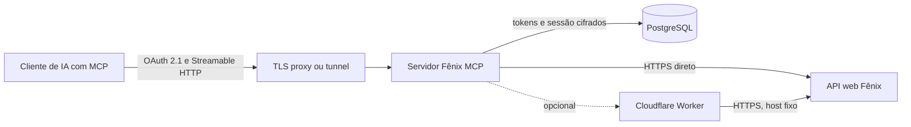

# Fênix MCP

Servidor MCP em Node.js que conecta clientes compatíveis com o Model Context Protocol à API web do Fênix. O cliente conversa com o MCP por Streamable HTTP e autentica cada usuário por OAuth 2.1. Depois da autorização, as ferramentas consultam operações do catálogo do frontend usando a sessão individual do usuário.

O repositório contém o servidor, o catálogo de operações observado no frontend, uma Skill de uso, as migrações PostgreSQL e um Worker opcional para encaminhar chamadas à API. O código pode ser público; a instância implantada continua protegida por OAuth e requer configuração e credenciais próprias.

## Arquitetura



O Worker é opcional. Quando habilitado, o e-mail, a senha e o resultado do hCaptcha usados no login, além dos cookies e das chamadas à API, passam pela Cloudflare antes de chegar ao host fixo do Fênix. A configuração do Wrangler desabilita os logs de invocação do Worker, mas isso não impede o processamento do tráfego pela Cloudflare.

## Recursos

- OAuth 2.1 com authorization code, PKCE S256, vinculação do token ao recurso MCP, refresh tokens rotativos e revogação.
- Login do usuário no Fênix durante a autorização. A senha e o token do hCaptcha são enviados apenas para a tentativa de login; a sessão resultante é cifrada no PostgreSQL.
- Catálogo de operações extraído do frontend, com filtros por método, classificação heurística, observação no navegador, texto e paginação.
- Ferramenta de chamada limitada às operações do catálogo; não aceita host nem caminho arbitrário. Escritas exigem confirmação explícita.
- Registro de falhas por autorização OAuth, com ferramentas para consultar incidentes e anexar um relatório de trabalho redigido.
- Skill disponível em `skill://fenix/SKILL.md`, além de um recurso MCP Markdown e instruções nas ferramentas e na inicialização.
- Worker Cloudflare opcional, com destino upstream fixo e segredo compartilhado.

## Requisitos

- Node.js 20 ou mais recente.
- PostgreSQL 14 ou mais recente.
- Um endereço HTTPS público para o emissor OAuth e o endpoint `/mcp`.
- Um reverse proxy TLS ou tunnel entre o endereço público e o listener local.
- Opcional: uma conta Cloudflare e Wrangler para o Worker upstream.

## Instalação e configuração

1. Instale as dependências e crie o arquivo de configuração local:

   ```sh
   npm install
   cp .env.example .env
   chmod 600 .env
   npm run keys
   ```

   `npm run keys` imprime os valores iniciais de `OAUTH_HMAC_KEYRING_JSON` e `OAUTH_ENCRYPTION_KEYRING_JSON`. Copie-os para `.env`. Não publique esses valores. Guarde uma cópia segura das chaves junto com o backup do banco: sem as chaves correspondentes, sessões cifradas não podem ser recuperadas. Ao fazer rotação, mantenha as chaves antigas até que os valores que dependem delas tenham expirado ou sido removidos.

2. Crie um banco PostgreSQL dedicado. Em `.env` ou no seu gerenciador de segredos, defina temporariamente `OAUTH_ADMIN_DATABASE_URL` e senhas distintas para os papéis com login. O `.env.example` mostra os nomes das variáveis. Execute as migrações:

   ```sh
   npm run migrate:oauth
   ```

   A migração aplica `sql/000_oauth_roles.sql`, `sql/001_oauth_store.sql` e `sql/002_api_failure_log.sql`. Configure `OAUTH_DATABASE_URL` para conectar como `fenix_mcp_runtime`. Os papéis de migração, runtime, revogação e restauração de metadados têm permissões separadas. Depois da migração, remova do ambiente os valores administrativos e as variáveis de senha usadas apenas para configurar os papéis. As migrações não são executadas automaticamente na inicialização.

3. Edite `.env`. Defina o endereço público HTTPS, a conexão runtime do banco e os dois keyrings. Confira os valores antes de iniciar:

   | Variável | Uso |
   | --- | --- |
   | `MCP_PUBLIC_URL` | Origem HTTPS pública do MCP e emissor OAuth, sem caminho; por exemplo, `https://mcp.example.com`. |
   | `OAUTH_DATABASE_URL` | Conexão PostgreSQL do papel runtime. O exemplo é para banco local; exija TLS e valide o certificado ao conectar a um banco remoto. |
   | `OAUTH_HMAC_KEYRING_JSON` | Keyring HMAC usado pelo armazenamento OAuth. |
   | `OAUTH_ENCRYPTION_KEYRING_JSON` | Keyring de criptografia para valores OAuth e sessões upstream. |
   | `MCP_HTTP_HOST`, `MCP_HTTP_PORT` | Endereço e porta locais; por padrão `127.0.0.1:3000`. |
   | `MCP_ALLOWED_HOSTS` | Hosts adicionais aceitos; use apenas os nomes esperados do proxy e do listener local. |
   | `MCP_ALLOWED_ORIGINS` | Origens de navegador adicionais, separadas por vírgula. A origem do emissor já é permitida. |
   | `MCP_HTTP_PATH` | Deve permanecer `/mcp` para manter a validação exata do recurso OAuth. |
   | `FENIX_BASE_URL` | Origem HTTPS da API ou do Worker opcional. Por padrão, usa o host oficial do Fênix. |
   | `FENIX_PROXY_TOKEN` | Segredo compartilhado com o Worker, necessário quando `FENIX_BASE_URL` usa a mesma origem de `MCP_PUBLIC_URL`. |
   | `FENIX_FRONTEND_VERSION` | Versão informada ao endpoint de login; valor padrão `2.19.1`. O catálogo mantém sua própria versão em `src/frontend-endpoints.json`. |
   | `FENIX_HCAPTCHA_SITEKEY` | Site key pública usada pela página de autorização. Não é um segredo. |
   | `FENIX_TIMEOUT_MS` | Limite de tempo das chamadas upstream; padrão `30000`. |
   | `FENIX_RATE_LIMIT_PER_MINUTE` | Limite local de chamadas ao Fênix por minuto; padrão `60`. |
   | `FENIX_GET_RETRIES` | Número máximo de tentativas adicionais para chamadas GET; padrão `1`. |

   O arquivo `.env.example` documenta os nomes e formatos esperados. Nunca coloque senhas, URLs com senha, keyrings ou tokens no Git.

4. Configure o proxy TLS ou tunnel para encaminhar o tráfego HTTPS público ao listener local. O processo escuta em loopback por padrão. Preserve os cabeçalhos de host necessários e configure o proxy para não registrar corpos de requisição, cookies ou cabeçalhos de autorização.

   O servidor limita corpos OAuth a 64 KiB e encerra a conexão quando esse limite é excedido. Ele também define prazos de 15 segundos para cabeçalhos, 30 segundos para receber a requisição completa e 5 segundos para conexões keep-alive. A página de autorização aceita até 60 consultas por minuto por endereço observado pelo listener. O banco admite até 1.000 identidades OAuth ao todo, incluindo clientes registrados dinamicamente e por documento de metadados; os caches em memória para metadados e JWKS são limitados a 500 entradas cada.

5. Inicie o servidor:

   ```sh
   npm start
   ```

   `GET /healthz` informa que o processo está respondendo e mostra a versão do catálogo e a quantidade de operações. A descoberta OAuth fica em `/.well-known/oauth-authorization-server`; os metadados do recurso protegido ficam em `/.well-known/oauth-protected-resource/mcp`.

## Conectar um cliente MCP

Configure a URL do servidor como `MCP_PUBLIC_URL/mcp` e selecione OAuth. O cliente também precisa alcançar o emissor na mesma origem HTTPS. Durante a autorização, o usuário entra no Fênix e resolve o hCaptcha; o servidor usa essa sessão para chamadas posteriores.

O protocolo oferece registro dinâmico de cliente e suporte a Client ID Metadata Documents. A autorização usa code + PKCE S256, restringe o token ao recurso MCP e suporta refresh rotativo e revogação. Uma chamada sem token válido recebe `401` e os metadados de descoberta OAuth apropriados.

Um tunnel privado para `/mcp` não publica automaticamente os endpoints OAuth. Para usar esse tipo de tunnel com clientes externos, publique também os endpoints OAuth e os metadados protegidos na origem HTTPS configurada em `MCP_PUBLIC_URL`.

## Ferramentas e uso seguro

| Ferramenta | Função |
| --- | --- |
| `fenix_list_endpoints` | Filtra e pagina as operações do catálogo. Para leitura, use `method=GET` e `access=read-only`; essa classificação é heurística. |
| `fenix_api_call` | Chama uma operação pelo `operation_id`, com parâmetros de caminho, filtros e corpo JSON. Não aceita destinos arbitrários. |
| `fenix_list_failures` | Lista os incidentes desta autorização OAuth, com filtro por operação e paginação. |
| `fenix_add_failure_report` | Anexa objetivo, passos, resultado, análise e próxima ação a um `incidentId` da mesma autorização. |

Para consultas, use somente operações `GET`; não invente identificadores nem envie corpo. Operações `POST`, `PUT`, `PATCH` e `DELETE` podem alterar dados reais e exigem `confirm_mutation=true`, mas a confirmação técnica não substitui o pedido do usuário. O catálogo não contém o esquema completo dos corpos, permissões de cada perfil ou todos os efeitos de negócio. Não teste escritas na produção. A validação ponta a ponta de operações de escrita exige homologação com registros descartáveis.

Operações de login, primeiro acesso, redefinição de senha e alteração de senha são bloqueadas na ferramenta genérica. Uploads e anexos binários não são suportados. Corpos JSON e respostas são limitados a 1 MB.

O servidor publica a Skill pela extensão MCP `io.modelcontextprotocol/skills` e pelos métodos `skills/list` e `skills/get`. Também fornece um recurso Markdown em `skill://fenix/SKILL.md`. Um cliente que não implemente a extensão ainda recebe instruções na inicialização e nas descrições das ferramentas; clientes que leem recursos MCP podem buscar a Skill diretamente.

## Registro e análise de falhas

Quando uma chamada à API falha, o servidor tenta registrar automaticamente um incidente e devolve seu `incidentId` e `incidentRecorded`. O registro contém o identificador e caminho-modelo da operação, método, status HTTP, nome e código de erro, campos de validação, nomes de chaves da resposta, tipo de conteúdo, formato da resposta e resultado da tentativa de mutação. Ele não guarda valores de corpo, query ou parâmetros substituídos, nem cookies ou respostas completas.

Depois da falha, o cliente pode anexar um relatório com o objetivo, os passos tentados, o resultado observado, uma análise e a próxima ação recomendada. O relatório deve conter apenas um resumo técnico: não inclua prompts completos, dados pessoais, valores enviados, IDs, e-mails, URLs, credenciais, tokens ou cookies. O servidor aplica mascaramento adicional, mas isso não garante detectar todo formato de dado sensível. Incidentes ficam isolados por autorização OAuth e são removidos após 180 dias; a limpeza ocorre na inicialização e periodicamente durante a execução.

Uma falha não prova que uma escrita foi rejeitada. Para operações mutáveis, `mutationOutcome=uncertain` significa que a chamada pode ter sido aplicada total ou parcialmente. Não repita a escrita até consultar o estado atual com uma operação GET autorizada ou pedir a uma pessoa para conferir no Fênix. `not_dispatched` indica falha local antes do envio.

## Worker Cloudflare opcional

Use o Worker somente se precisar que o servidor encaminhe chamadas pela Cloudflare. O Worker aceita a rota `/api/v1/*`, usa um upstream fixo e exige o segredo `FENIX_PROXY_TOKEN`. A configuração de exemplo usa um domínio reservado; substitua-o por um domínio sob seu controle tanto em `cloudflare/fenix-upstream-proxy/wrangler.jsonc` quanto em `MCP_PUBLIC_URL` e `FENIX_BASE_URL`, conforme a topologia do serviço. Consulte [cloudflare/fenix-upstream-proxy/README.md](cloudflare/fenix-upstream-proxy/README.md) para implantação e limites.

Esse caminho permite que o tráfego saia da Cloudflare em direção ao host upstream, mas não muda onde o servidor MCP está hospedado. A região em `placement` é uma indicação de posicionamento, não uma garantia de localização ou IP de saída; confirme a região observada em uma chamada sem credenciais antes de usar o proxy para login. A Cloudflare ainda processa os payloads enquanto os encaminha.

## Limitações conhecidas

- O catálogo foi extraído do frontend e de chamadas observadas no navegador; ele não representa todas as rotas ou permissões do backend.
- A classificação de acesso do catálogo é heurística. Para consultas, o método `GET` é o critério operacional.
- Nem todas as operações documentam os parâmetros obrigatórios. Respostas `422` são resumidas com campos de validação quando o upstream os fornece, sem devolver o corpo completo ou os valores enviados.
- O site key de hCaptcha pode exigir autorização do domínio usado na página OAuth. Se o widget rejeitar o host, configure uma site key aceita pelo serviço upstream em `FENIX_HCAPTCHA_SITEKEY`.
- No catálogo baseado no frontend `2.19.1`, `get_edifications` e `get_solicitacoes_param_retificacoes` tiveram respostas upstream `404` e `405`. São ocultadas por padrão e podem ser vistas com `include_unavailable=true`.
- Nenhuma resposta de saúde, inicialização OAuth ou listagem de ferramentas comprova que todas as operações funcionam no backend. Não há garantia de sucesso sem uma chamada real autorizada.
- Operações de escrita não foram verificadas em homologação; use apenas um ambiente e dados descartáveis para validar seus esquemas e efeitos.

Consulte as [notas de evidência e a tabela de operações](docs/frontend-endpoints.md) e o [catálogo JSON](src/frontend-endpoints.json).

## Desenvolvimento e manutenção

```sh
npm run docs:endpoints
```

Esse comando regenera a documentação do catálogo em `docs/frontend-endpoints.md`. Mudanças de schema PostgreSQL devem ser feitas em uma nova migração SQL e aplicadas explicitamente com `npm run migrate:oauth` por uma conexão administrativa. O serviço não altera o schema durante a inicialização.

Ao fazer backup do PostgreSQL, proteja o arquivo com o mesmo cuidado das chaves de criptografia. Restrinja os papéis e os arquivos de ambiente, monitore o espaço e a retenção dos incidentes, e nunca habilite logs de requisições que capturem credenciais, cookies ou corpos da API.
